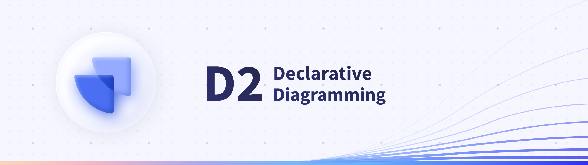
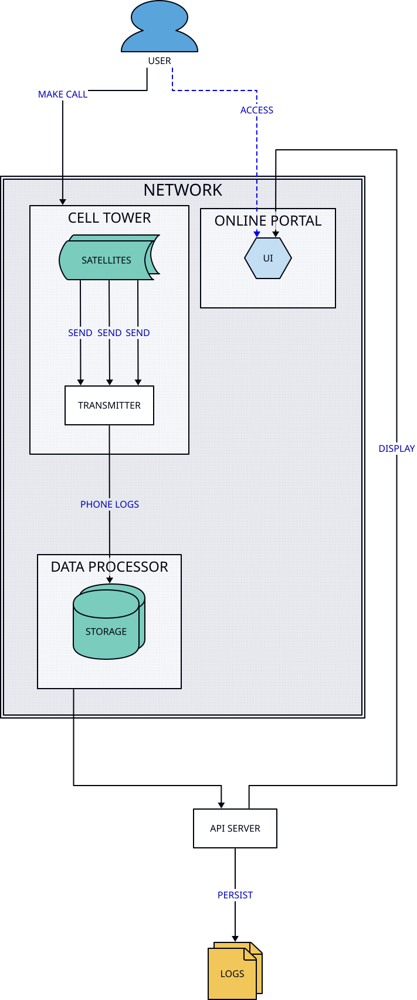
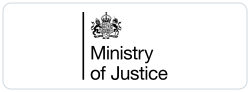

<div align="center">
  
  <h2>
    A modern diagram scripting language that turns text to diagrams.
  </h2>

[Docs](https://d2lang.com) | [Cheat sheet](./docs/assets/cheat_sheet.pdf) | [Comparisons](https://text-to-diagram.com) | [Playground](https://play.d2lang.com)

[](https://github.com/d2lang/d2/actions/workflows/ci.yml)
[](https://github.com/d2lang/d2/actions/workflows/weekly-race.yml)
[](https://github.com/d2lang/d2/releases)
[](https://d2lang.com/releases/intro/)
[](https://www.npmjs.com/package/@d2lang/d2)
[](https://discord.gg/NF6X8K4eDq)
[](./LICENSE.txt)

<a href="https://play.d2lang.com">

</a>

https://user-images.githubusercontent.com/3120367/206125010-bd1fea8e-248a-43e7-8f85-0bbfca0c6e2a.mp4

</div>

<p align="center">
    
</p>

<details>
<summary>Source code</summary>

```d2
vars: {
  d2-config: {
    layout-engine: elk
    theme-id: Terminal
  }
}
network: {
  cell tower: {
    satellites: {
      shape: stored_data
      style.multiple: true
    }

    transmitter

    satellites -> transmitter: send
    satellites -> transmitter: send
    satellites -> transmitter: send
  }

  online portal: {
    ui: {shape: hexagon}
  }

  data processor: {
    storage: {
      shape: cylinder
      style.multiple: true
    }
  }

  cell tower.transmitter -> data processor.storage: phone logs
}

user: {
  shape: person
  width: 130
}

user -> network.cell tower: make call
user -> network.online portal.ui: access {
  style.stroke-dash: 3
}

api server -> network.online portal.ui: display
api server -> logs: persist
logs: {shape: page; style.multiple: true}

network.data processor -> api server
```

</details>

[Open in Playground](https://play.d2lang.com/?script=rVLLTsQwDLznKyJxbrWwtyLxFdyR1Zg2ahpHibvLCvXfcdqGfSHthVv8yIxn7APE1OhvpbV5qVryn7ZbQ60dnGjiCn1nPTYa3bCkn_Q7xtF6cJp7HFG3ZHCpLGFlTaP3u51kZjUrj3ykOKyYLTr5REeMhSMBS84yppKRXA9B-BJTRPNhgKEU-OSwHifHNjjp4DitxLNa-SP4NFpmjOoGXVdvl2VBR2_-sWeZgLwTp3SgyOCKnsnKa5PU4xd05OfyIWvTIVKLKdHZExEOHd4Z0p4E3oi2h25s8Ge764uZs4Rr4vqXMfQkAhx1SVanplQWtU0QMCbyEh-t4b7Rz_td6cuo267ryzWPMMiFgHN3XVdu1dkmaPM8K-EiLnGkASsDScj2mQqCFcvj4RGUsSnI_d70Z2GrCptYrVHZTRADXv80VWgL0bVvGfJMoH4A) · [Browse more examples](https://d2lang.com/examples/overview/)

## Trusted by

Organizations around the world use D2 to power blog posts and docs both internally and externally. D2 is also integrated into many popular tools and services.

<p align="center">
  <a href="https://github.com/ai-dynamo/dynamo/blob/c14d1e627ec6d96430ea94cfe340418ce496f5fd/docs/fern/pages/blog/_assets/agentic-inference/kv-memory-hierarchy.d2" title="Dynamo’s KV cache memory hierarchy"></a>
  <a href="https://github.com/GoogleCloudPlatform/scion/blob/c1208b6f49cdbd4676df4377c3bc15ba26b96427/docs-site/src/content/docs/contributing/architecture.md?plain=1#L23-L43" title="Google Cloud Scion architecture"></a>
  <a href="https://github.com/awslabs/nx-plugin-for-aws/blob/dd639aa541e880083d716191299609a02dd20dfa/docs/src/content/docs/en/snippets/agent/architecture.mdx?plain=1#L11-L43" title="AWS Labs’ Bedrock AgentCore architecture"></a>
  <a href="https://github.com/gitlabhq/cli/blob/093bdd1b82d84dd066eefc9fac91d382e3128899/internal/commands/cluster/graph/server.go#L232-L248" title="How the GitLab CLI renders cluster graphs with D2"></a>
  <a href="https://github.com/SamsungDS/gears_h/blob/f1dda8c547a7b25468550eabd8ae4a2494111b20/architecture_figures/0_overview.d2" title="Samsung Device Solutions’ GEARS H model architecture"></a>
  <a href="https://github.com/stripe/sync-engine/blob/0cb8ca453d7ad266de714f83838f4e38565e8a57/docs/d2.mjs#L15-L25" title="How Stripe Sync Engine renders documentation diagrams with D2.js"></a>
  <a href="https://github.com/alibaba/kubeskoop/blob/5da8ccbbc66289c31dd1364170c880bead89e030/pkg/skoop/ui/graph.go#L43-L91" title="How Alibaba KubeSkoop renders network paths with D2"></a>
  <a href="https://github.com/langchain-ai/design-agent/blob/86d8f667796890eb6d3612dbd1b9e941782fe03f/skills/data-viz/scripts/lib/d2.mjs#L99-L114" title="How LangChain’s Design Agent invokes D2"></a>
  <a href="https://github.com/ministryofjustice/hmpps-probation-integration-services/blob/b79d1f51670f09e6d60c07c8ffd57dfe72ae5483/doc/diagrams/approved-premises-and-delius-workflow-application.d2" title="HM Prison and Probation Service’s Approved Premises application workflow"></a>
</p>

## Quickstart

<a name="install"></a>

On macOS or Linux, run the install script.

```sh
curl -fsSL https://d2lang.com/install.sh | sh -s --
```

On x64 Windows, download the MSI installer from the [latest release](https://github.com/d2lang/d2/releases/latest).
The [installation guide](./docs/INSTALL.md) covers other platforms, package managers, and uninstalling.

Save `x -> y -> z` in a file named `hello.d2`, then run the following command to create `hello.svg`.

```sh
d2 hello.d2
```

With [uv](https://docs.astral.sh/uv/), run the native CLI directly with `uvx d2lang hello.d2`.

For a live preview in your browser, run `d2 --watch hello.d2` and edit the file.

## D2 as a library

You can render diagrams from Go with `d2lib` or from JavaScript and TypeScript with
`@d2lang/d2`.

[Go examples](./docs/examples/lib) · [D2.js usage guide](./d2js/js/README.md#usage)

## Themes

D2 includes a variety of official themes to style your diagrams beautifully right out of
the box. See [./d2themes](./d2themes) to browse the available themes and make or
contribute your own creation.

## Fonts

D2 ships with "Source Sans Pro" as the font in renders. If you wish to use a different
one, please see [./d2renderers/d2fonts](./d2renderers/d2fonts).

## Export file types

D2 renders SVG, PNG, GIF, PDF, PowerPoint (`.pptx`), and text diagrams (`.txt`) without a browser.
For example, `d2 hello.d2 hello.txt` draws the diagram with Unicode characters.
Use `--ascii-mode=standard` for plain ASCII. [Export guide](https://d2lang.com/tour/exports/)

For animated SVG and GIF, set `animate-interval` and `animate-duration` in
`vars.d2-config`. With TALA, newly appended SQL rows can drop into place
while existing rows and connections stay anchored. Appending a sequence message can
extend the activation bar and draw the arrow from sender to recipient.
[Animated TALA example](./docs/examples/tala-step-motion/dispatch.gif) · [D2 source](./docs/examples/tala-step-motion/dispatch.d2)

A positive `animate-interval` cycles through all exported boards, including
linked layers. Link a shape with `gateway.link: layers.gateway` and set
`animate-duration` to zoom through that shape when playback enters the layer
and pull back when it returns to the overview. Moving between linked siblings
zooms out to their parent and then into the next layer. Across branches, the
camera follows the links through the nearest common ancestor. These moves
share one transition duration. Clicking a linked shape in a standalone SVG
pauses the tour for manual navigation.
[Order fulfillment example](./docs/examples/order-fulfillment/order-fulfillment.svg) · [D2 source](./docs/examples/order-fulfillment/order-fulfillment.d2)

To review an animation, run `d2 storyboard film.d2 board.png`. Open the PNG to
see each board and its timestamp in playback order, including intermediate frames
from animated transitions. Panels share the animated SVG’s coordinate system, so
a shape that moves between boards changes position in the sheet.
Run `d2 lint --motion film.d2` to find crowded
transitions, short-lived labels, hidden caption targets, and possible shape ID
replacements. The D2 MCP server exposes the same operations as `storyboard`
and `lint_motion`, so a model can inspect the image, edit the source, and check
the next render.

## Layout engines

D2 bundles three layout engines. Select one with `--layout=dagre`, `--layout=elk`, or
`--layout=tala`. You can also set `D2_LAYOUT` or `vars.d2-config.layout-engine` in D2 source.
Run `d2 layout` to list the engines or `d2 layout <name>` for their configuration options.

- [Dagro](https://github.com/d2lang/dagro) (default, bundled): A native Go port of the
  Dagre directed graph layout engine that produces layered/hierarchical layouts. Based
  on Graphviz's DOT algorithm.
- [elk-go](https://github.com/d2lang/elk-go) (bundled): A native Go port of the ELK
  directed graph layout engine, particularly suited for node-link diagrams with an
  inherent direction and ports.
- [TALA](./d2layouts/d2talalayout) (bundled): Native layout and edge-routing engine designed
  specifically for software architecture diagrams.

D2 also handles specialized layouts such as sequence diagrams and grids. Go applications
can use the [layout packages](./d2layouts) directly or provide layout and routing functions
through [d2lib](./d2lib).

Sketch-mode rendering uses [rough-go](https://github.com/d2lang/rough-go), a native Go
compatibility port of the Rough.js 4.6.6 rendering surface used by D2.

LaTeX labels use [mathjax-go](https://github.com/d2lang/mathjax-go), a native Go port of
the MathJax 3.2.2 TeX-to-SVG pipeline.

## Comparison

For a comparison against other popular text-to-diagram tools, see
[https://text-to-diagram.com](https://text-to-diagram.com).

## Contributing

Contributions are welcome! See [./docs/CONTRIBUTING.md](./docs/CONTRIBUTING.md).
Parser and editor authors can use the [structural grammar](./docs/grammar/structure.ebnf),
[lexical grammar](./docs/grammar/lexical.ebnf), and [conformance cases](./docs/grammar/testdata/).

D2 is an independent open-source project fiscally sponsored by Hack Club.
[Sponsor D2](https://d2lang.com/sponsor/)

## License

Open sourced under the Mozilla Public License 2.0. See [./LICENSE.txt](./LICENSE.txt).

## Related

We are constantly working on new plugins, integrations, extensions. Contributions are
welcome in any official or community plugins. If you have somewhere in your workflow that
you want to use D2, feel free to open a discussion. We have limited bandwidth and usually
choose the most high-demand ones to work on. If you make something cool with D2 yourself,
let us know and we'll be happy to include it here!

### Official plugins

- **VS Code** — Install [d2lang, the official D2 extension](https://marketplace.visualstudio.com/items?itemName=d2lang.d2lang). [Source code](https://github.com/d2lang/d2-vscode)
- **Vim extension**: [https://github.com/d2lang/d2-vim](https://github.com/d2lang/d2-vim)
- **Obsidian plugin**: [https://github.com/d2lang/d2-obsidian](https://github.com/d2lang/d2-obsidian)

### Community integrations

<a name="community-plugins"></a>

**Libraries and publishing**

- [Astro D2](https://astro-d2.vercel.app/getting-started/) — Render D2 code blocks in Astro or remark.
- [MkDocs D2](https://landmaj.github.io/mkdocs-d2-plugin/guide/usage/) — Embed D2 diagrams in MkDocs pages.
- [d2-python](https://github.com/h0rv/d2-python#coming-from-py-d2) — Build D2 source from typed Python. Includes a migration guide for py-d2.
- [VitePress D2](https://github.com/BadgerHobbs/vitepress-plugin-d2#readme) — Render D2 code blocks in VitePress.
- [mdBook D2](https://github.com/danieleades/mdbook-d2#readme) — Render D2 code blocks in mdBook.

**Editors and notes**

- [Zed](https://zed.dev/extensions/d2) — Add D2 language support in Zed.
- [JetBrains IDEs](https://plugins.jetbrains.com/plugin/29542-d2-diagram) — Edit, format, and preview D2 diagrams.
- [Emacs Org Babel](https://github.com/xcapaldi/ob-d2#readme) — Evaluate D2 source blocks in Org documents.
- [Logseq D2](https://github.com/b-yp/logseq-d2#readme) — Render D2 diagrams offline in Logseq using WebAssembly.

**Tools with D2 support**

- [dependency-cruiser](https://github.com/sverweij/dependency-cruiser/blob/main/doc/cli.md#d2) — Export JavaScript and TypeScript dependency graphs to D2.
- [LikeC4](https://likec4.dev/tooling/cli/#generate-mermaid-dot-d2-plantuml) — Export architecture views to D2.
- [Markdown Preview Enhanced](https://github.com/shd101wyy/markdown-preview-enhanced/blob/master/docs/diagrams.md#d2) — Preview D2 code blocks in Markdown using the local D2 CLI.
- [Kroki](https://docs.kroki.io/kroki/setup/configuration/#_d2) — Render D2 through an HTTP API. It also powers D2 previews in [GitLab instances with Kroki enabled](https://docs.gitlab.com/administration/integration/kroki/).
- [KubeDiagrams](https://github.com/philippemerle/KubeDiagrams#d2-diagram-generation) — Generate D2 diagrams from Kubernetes manifests and Helm charts.
- [Mark for Confluence](https://github.com/kovetskiy/mark#readme) — Publish Markdown with rendered D2 diagrams to Confluence.
- [Asciidoctor Diagram](https://docs.asciidoctor.org/diagram-extension/latest/diagram_types/d2/) — Render D2 blocks in AsciiDoc using the D2 CLI.

### Misc

- **Comparison site**: [https://github.com/d2lang/text-to-diagram-site](https://github.com/d2lang/text-to-diagram-site)
- **Playground**: [https://github.com/d2lang/d2-playground](https://github.com/d2lang/d2-playground)
- **Language docs**: [https://github.com/d2lang/d2-docs](https://github.com/d2lang/d2-docs)
- **Hosted icons**: [https://icons.d2lang.com](https://icons.d2lang.com)

## FAQ

- Does D2 collect telemetry?
  - No, D2 does not use an internet connection after installation, except to check for
    version updates from Github periodically.
- Does D2 need a browser to run?
  - No, D2 can run entirely server-side.
- What's coming in the next release?
  - See [./ci/release/changelogs/next.md](./ci/release/changelogs/next.md).
- I have a question or need help.
  - The best way to get help is to ask on [D2 Discord](https://discord.gg/NF6X8K4eDq)
- I have a feature request, proposal, or bug report.
  - Please open up a Github Issue.
- I have a private inquiry.
  - Please reach out at <alex@d2lang.com>.
