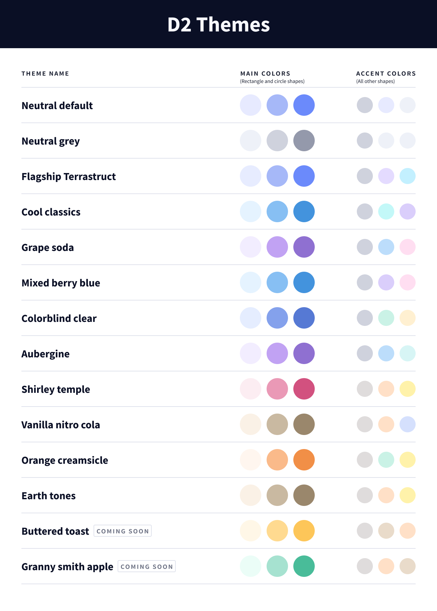
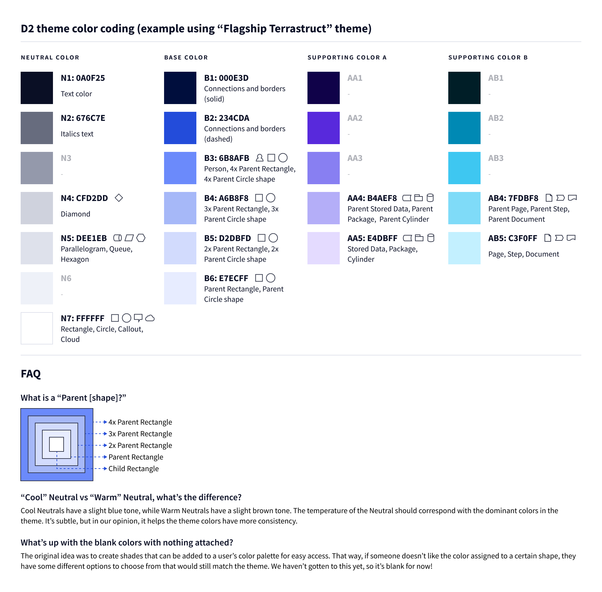
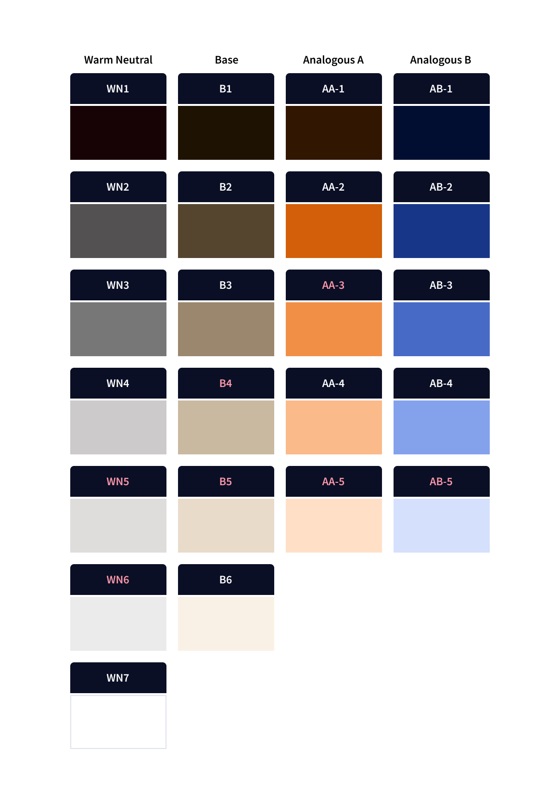

# d2themes

`d2themes` defines themes for D2. You can add a new one in `./d2themescatalog`, give a
unique ID, and specify it in the CLI or library to see it.

Run `d2 themes` to list the available names and IDs. For example, you can select
Shirley Temple (ID 102) in a diagram and use Dark Mauve for dark mode.

```d2
vars: {
  d2-config: {
    theme-id: Shirley Temple
    dark-theme-id: Dark Mauve
  }
}
```

Theme names are case-insensitive. You can use hyphens for spaces, as in
`shirley-temple`, or pass the name as a single CLI argument.

```sh
d2 --theme "Shirley Temple" in.d2 out.svg
```

Run `d2 --help` or `man d2` for more.


# Themes overview



# Color coding guide

To distinguish container nesting, objects get progressively lighter the more nested it is.



# Color coding example


